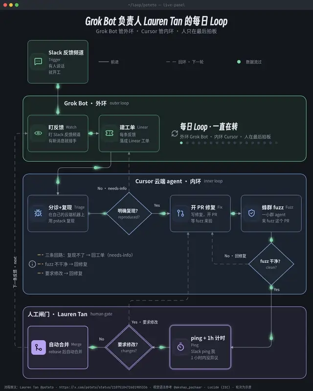
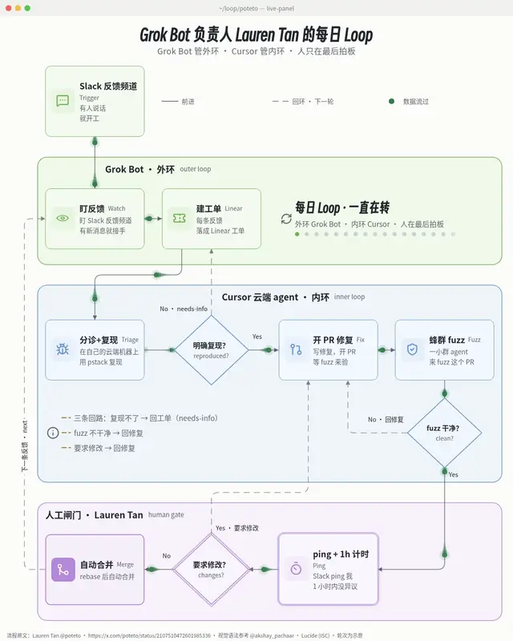
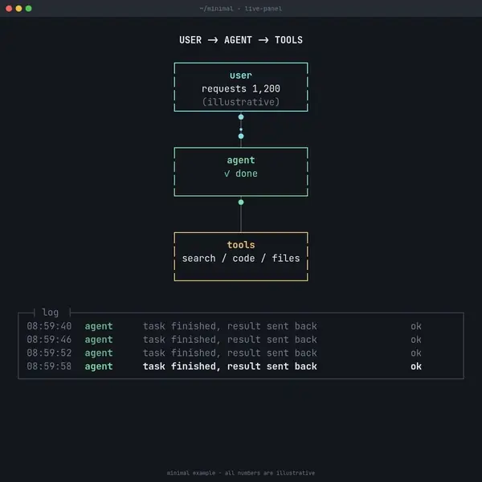
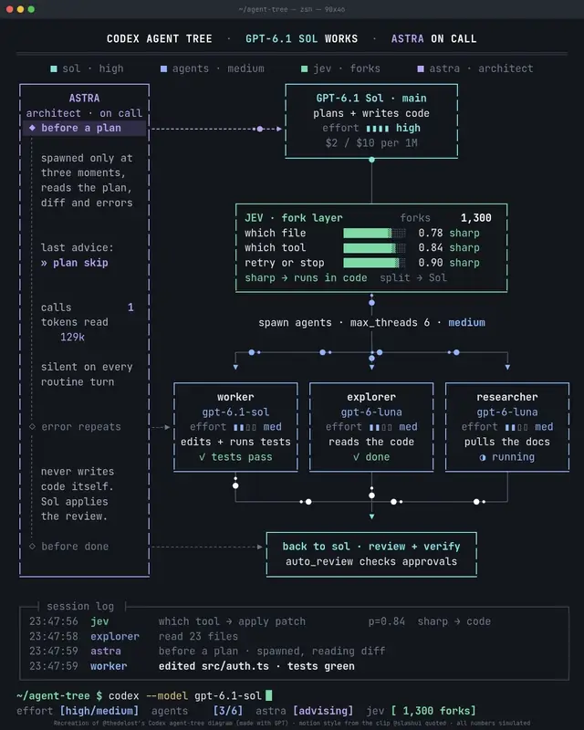
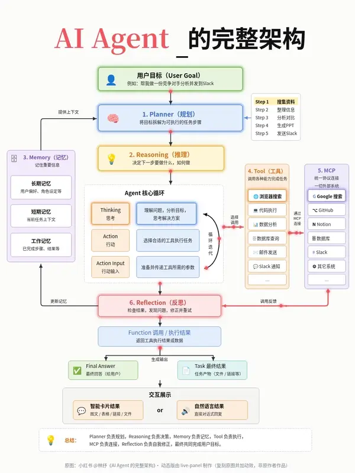
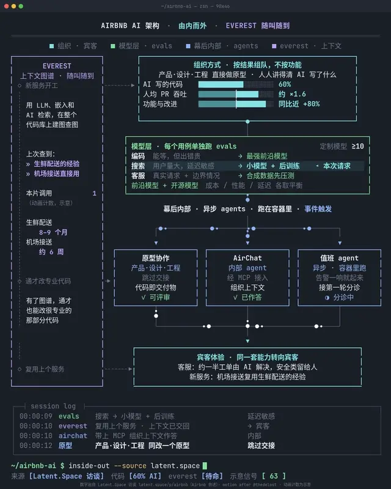
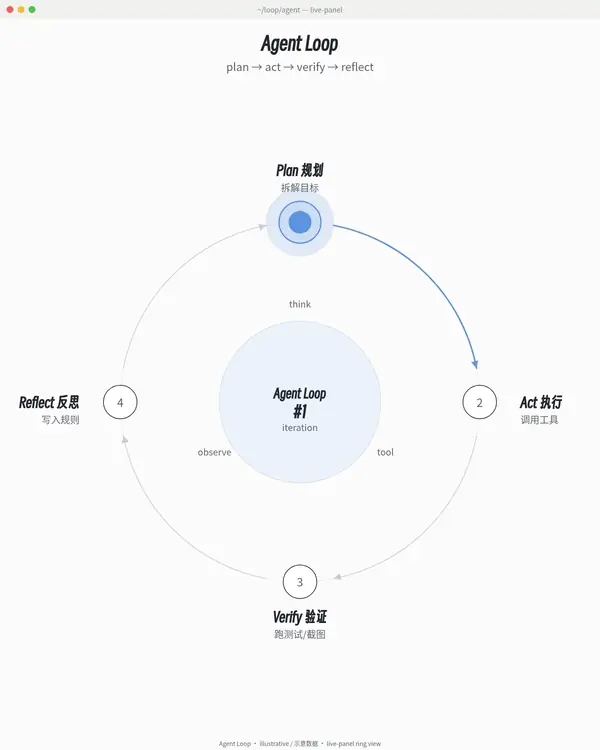
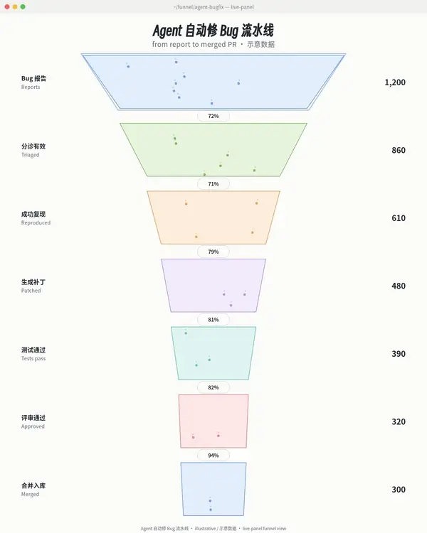

# live-panel: animated architecture diagrams from one JSON file

**English** | [中文说明](#中文说明)

| `loop` view · terminal-dark | `loop` view · light-pastel |
| --- | --- |
|  |  |

<sub>Grok Bot 负责人 Lauren Tan 的每日 Loop. The workflow is from [Lauren Tan @poteto](https://x.com/poteto/status/2107510472601985336); the visual grammar follows an infographic by [@akshay_pachaar](https://x.com/akshay_pachaar); icons are [Lucide](https://lucide.dev) (ISC). Made with this repo: `examples/loop-poteto/config.json`.</sub>

**live-panel is an open-source agent skill and renderer that turns one JSON config into an animated architecture diagram: a terminal-style "live panel" (or a light pastel infographic) rendered to an H.264 mp4 or a self-contained web page.** The layout stays fixed while the system looks like it is running: packets flow along the wires, a log scrolls, counters tick, bars flip state and side triggers light up in turn.

> 中文一句话：**live-panel 把一个 JSON 配置渲染成会动的架构图**——终端监控面板风格的动态架构图 / agent 架构动图，或会动的浅色信息图，输出 mp4 视频或可循环的网页，画幅预设适配 X（4:5）和小红书（3:4）。

- **Input:** one JSON file (boxes, wires, packet paths, log wording, counters). Start from an example; the HTML template never needs editing.
- **Output:** H.264 mp4 (30 fps, silent AAC track) and/or a self-contained HTML page that loops live in any browser.
- **Looks:** `terminal-dark` (monitoring panel in a terminal window) and `light-pastel` (Xiaohongshu-style infographic). Canvas presets `4:5` 1200x1500 (X), `3:4` 1080x1440 (Xiaohongshu), `1:1` 1080x1080.
- **Use it for:** agent architecture diagrams, multi-agent / agent-tree panels, system and data-flow diagrams, "monitoring dashboard" style posts.
- **For AI agents:** `SKILL.md` makes it a skill for Claude Code, Codex and other agents that read SKILL.md; the agent writes the JSON, renders and checks frames itself.
- **Credit:** the look and motion idea come from a clip by [@thedelost](https://x.com/thedelost); see *Credits* below.
- **Requirements:** Python 3.8+ (standard library only), Chrome or Chromium, ffmpeg. No API key, no network, no pip packages. MIT licensed code.

## Quick start: a minimal JSON config

Save this as `minimal.json` (it is also `examples/minimal/config.json`):

```json
{
  "canvas": {"preset": "1:1", "duration": 12, "fps": 30, "preroll": 4},
  "theme": {"preset": "terminal-dark"},
  "clock": {"start": "09:00:00", "rate": 1},
  "titlebar": {"text": "~/minimal - live-panel"},
  "credit": {"text": "minimal example - all numbers are illustrative", "y": 1060},
  "machines": {
    "reqs": {"type": "counter", "start": 1200, "rate": 7, "format": "comma"},
    "agent": {"type": "lane", "period": 6, "run": 4, "off": 0.5, "busy": "working", "done": ["done"],
              "log": {"who": "agent", "c": "gr", "msgs": [["task finished, result sent back", "ok"]]}}
  },
  "elements": [
    {"type": "text", "x": 0, "w": 1080, "y": 90, "align": "center", "runs": [{"t": "USER -> AGENT -> TOOLS", "c": "fg", "b": 1}]},
    {"type": "box", "x": 390, "y": 140, "w": 300, "h": 110, "color": "cy", "pad": [12, 14],
     "lines": [{"t": "user", "c": "cy", "b": 1}, {"runs": ["requests ", {"v": "reqs"}]}, {"t": "(illustrative)", "c": "dim"}]},
    {"type": "line", "from": [540, 250], "to": [540, 330]},
    {"type": "box", "x": 390, "y": 330, "w": 300, "h": 110, "color": "gr", "pad": [12, 14],
     "lines": [{"t": "agent", "c": "gr", "b": 1}, {"runs": [{"v": "agent"}]}]},
    {"type": "line", "from": [540, 440], "to": [540, 520]},
    {"type": "box", "x": 390, "y": 520, "w": 300, "h": 110, "color": "ye", "pad": [12, 14],
     "lines": [{"t": "tools", "c": "ye", "b": 1}, "search / code / files"]},
    {"type": "flow", "path": [[540, 250], [540, 330]], "period": 1.5, "offsets": [0, 0.7], "color": "cy"},
    {"type": "flow", "path": [[540, 440], [540, 520]], "period": 2, "offsets": [0.3], "color": "gr"},
    {"type": "log", "x": 40, "y": 700, "w": 1000, "rows": 4, "padTop": 16, "padBottom": 30, "padLeft": 20,
     "title": "log", "titleX": 36, "titleW": 80,
     "cols": [{"key": "time", "x": 0}, {"key": "who", "x": 130}, {"key": "m", "x": 260}, {"key": "g", "x": 860}]}
  ]
}
```

```bash
git clone https://github.com/ythx-101/live-panel-skill && cd live-panel-skill
python3 scripts/render.py --config examples/minimal/config.json --out minimal.mp4 --html-out minimal.html
python3 scripts/check_frames.py --config examples/minimal/config.json --out-dir frames --repeat   # exit 0 = no overflow/overlap, replay identical
```



> ## Credits - please read
> - **The idea, the look and the motion grammar come from an architecture-diagram clip by [@thedelost](https://x.com/thedelost)** (a Codex agent-tree panel, generated with GPT, screen-recorded as a web page): <https://x.com/thedelost/status/2105398038026195279>. It spread via a quote-post by **[@slashui](https://x.com/slashui)**: <https://x.com/slashui/status/2105850132365443528>.
> - `examples/codex-agents/` is a **recreation of that original picture** (layout, content and the three-tempo motion, redrawn from frame captures of the clip). The design belongs to @thedelost. The method (motion grammar, config-driven template) is re-implemented here and is not their code.
> - `examples/agent-architecture/` re-animates the static Xiaohongshu infographic **《AI Agent 的完整架构》 by 小红书 @林纾** (posted Sep 4). Layout, wording and colours follow the original; the design belongs to the original author. The footer of the video says so.
> - `examples/airbnb/` visualises figures Airbnb leaders stated in the **Latent.Space interview** <https://www.latent.space/p/airbnb>. The numbers are Airbnb's own account; the animation counters are illustrative.

## What it looks like

| terminal-dark, 4:5 - recreation of [@thedelost](https://x.com/thedelost)'s Codex agent tree | light-pastel, 3:4 - 林纾's AI Agent architecture |
| --- | --- |
|  |  |
| **terminal-dark, 4:5 - Airbnb, Chinese content, figures from the interview** | **1:1 - the minimal example above** |
|  |  |

The previews are animated WebP (one full loop, 12-15 fps, about 600 px wide). Full-size videos: `examples/<name>/<name>.mp4` (30 fps, silent AAC track so chat apps do not treat them as GIFs).

## Install and use

Requirements: Python 3.8+ (standard library only), Chrome or Chromium, ffmpeg. No pip packages.

Platforms: Linux and macOS. On macOS the browser is found automatically under `/Applications` (Google Chrome, Chromium, Edge, Brave); pass `--chrome` to override. Windows is not supported natively because Chrome is driven over a DevTools pipe on POSIX file descriptors 3/4 (`pass_fds`), which Windows lacks; run the scripts unchanged inside WSL instead (`apt install chromium ffmpeg`, then render from `/mnt/c/...`).

```bash
python3 scripts/render.py --config examples/codex-agents/config.json --out out.mp4
python3 scripts/check_frames.py --config examples/codex-agents/config.json --out-dir frames --repeat
```

- `render.py` options: `--width --height --duration --fps` (default from the config), `--chrome --ffmpeg` (default: found on PATH, Chrome also under `/Applications` on macOS), `--html-out page.html` (keep the self-contained live page), `--keep-frames DIR`, `--audio none`, `--crf`.
- `check_frames.py` samples ~120 time points, measures text overflow / overlap from the DOM, writes a few PNGs and (with `--repeat`) re-renders each exported frame after seeking away to prove it is identical. Exit status 1 on any problem.
- To use as a skill, put this folder where your agent loads skills (for Claude Code: `~/.claude/skills/live-panel/`).

### Make your own

1. Copy an example config. 2. Edit text, numbers, colours, positions. 3. Render, run `check_frames.py`, look at the PNGs. Nothing in `assets/template.html` has to change.

## Views: pick a diagram shape (视图)

Besides free-form boxes and wires, a config can hold `{"type":"view","kind":...}` elements: ready-made diagram shapes that lay themselves out inside a rect, work at 4:5 / 3:4 / 1:1 and in both themes, and animate by the same motion grammar. Contract and per-view data: [`references/views.md`](references/views.md); acceptance gate: `scripts/verify_view.py` ([`references/verify-view.md`](references/verify-view.md)).

| what you want to show | view | status |
| --- | --- | --- |
| a loop that repeats (agent plan→act→verify, PDCA, release cycle) | `ring` - 3-8 steps on a circle, comet, lap counter | ready (`examples/ring/`) |
| how many survive each stage (bug→merged PR, signup→paid) | `funnel` - widths proportional to values, conversion % between stages | ready (`examples/funnel/`; log widths + one-accent palette for population-scale data: `examples/funnel-karpathy/`) |
| a nested workflow with decisions and loop-backs (outer / inner loop, retry on "no", human gate) | `loop` - grouped frames, icon cards, decision diamonds, dashed loop-backs, a token walking the script | ready (`examples/loop-poteto/`) |
| who relates to whom, clusters of a knowledge base or ecosystem | `nebula` - force layout by group, halos, packets on strong edges | planned |
| work over time, parallel tracks, dependencies | `timeline` - lanes, playhead, done/active/pending | planned |
| a hierarchy (agent → sub-agents → tools, org chart) | `tree` - tidy tree, expand/collapse without layout jumps | planned |
| a few numbers to watch (latency, cost, pass rate) | `kpi` - card grid, big number, sparkline cursor = shown value | planned |
| an architecture with arbitrary boxes and wires | no view: free-form `box`/`path`/`flow` elements (the three original examples) | ready |

| `ring` - a comet laps the steps, the centre counts iterations | `funnel` - particles fall stage by stage, widths follow the values |
| --- | --- |
|  |  |
| **`loop` - packets on every wire, marching loop-backs, icons that move** | **`loop`, light-pastel** |
|  |  |
| **`excalidraw` - hand-drawn Excalidraw look that keeps running: pen loops, inked arrows, boiling lines** | **`excalidraw`, Chinese (小赖 Xiaolai handwriting)** |
|  |  |

Every view example also has an mp4 in its folder.

**Already drew it in Excalidraw?** Import the file and it starts moving:

```bash
python3 scripts/excalidraw_import.py my-diagram.excalidraw -o my-diagram.json
python3 scripts/render.py --config my-diagram.json --out my-diagram.mp4
```

Rectangles, ellipses and diamonds become nodes, all drawn as rounded boxes (their text becomes title + subtitle, their fill the nearest pastel; rotation is ignored). Arrows keep their **bindings**: an arrow attached to two shapes becomes an edge `from`/`to` those node ids, so the steps can follow it; a straight bound arrow is re-anchored on the node sides (move a box and it follows), while elbow/curved arrows keep their drawn route as fixed `pts` (move a box and you must edit or drop `pts`). Dashed ones march, arrow labels stay (re-placed beside the arrow). The step order is walked along the arrows (or pass `--order "Agent,Tools,..."`); add a `note` to any step in the JSON. Frames, images and freehand strokes are skipped; `.excalidrawlib` libraries and copied clipboard JSON import too. Example: `examples/excalidraw-import/`.

Rule of thumb: one view per picture; if the story needs two shapes, make two clips. Unlabelled numbers are illustrative and must say so on screen.

## Themes and canvas

```jsonc
"canvas": { "preset": "3:4", "duration": 28, "fps": 30, "preroll": 0 },   // or width/height explicitly
"theme":  { "preset": "light-pastel", "colors": { "pk": "#f0575f" } }      // preset + your overrides
```

| `canvas.preset` | size | typical use |
| --- | --- | --- |
| `4:5` | 1200x1500 | X (the original clip's format) |
| `3:4` | 1080x1440 | Xiaohongshu |
| `1:1` | 1080x1080 | square |

Positions in a config are absolute canvas pixels, so a config is authored for one canvas; `render.py --width/--height` only rescales (letterboxes) it. For another ratio, copy the config and re-place the boxes.

| `theme.preset` | look |
| --- | --- |
| `terminal-dark` | dark window, monospace, segmented text-mode boxes (the original clip's style) |
| `light-pastel` | white background, rounded pastel boxes, SVG arrows with rounded corners, soft glow on active items |

A theme controls: font and size, line height, the colour table (`colors`, any names you like), box mode (`segmented` or `solid`), corner radius, border width, wire width, packet size and glow, background. Add your own preset by editing `THEME_PRESETS` at the top of the boot code in the template, or override per config.

## Config reference (short)

Full tables are in [`references/config-schema.md`](references/config-schema.md).

- `elements`: `text`, `box` (fill, border colour, radius, dash, `container`, per-line `items`/`bar`/`runs`), `line`, `path` (polyline with rounded corners, arrow head, dash, `when/then` colour change, embedded packets), `glyph`, `rule`, `flow` (packets along a polyline, optional `when`), `tarrow` (trigger arrows), `log`.
- `machines` (everything that changes, all pure functions of time): `counter`, `cycle`, `gauge`, `any_low`, `lane`, `triggers`.
- `when` / `then` on boxes, paths, flows, lines and runs: highlight things from machine variables (`{"var":"seq.i","in":[0,1,2]}`; a list of conditions means AND).
- Motion rules: [`references/motion-grammar.md`](references/motion-grammar.md).

## How replay works (determinism)

The page exposes `window.seek(t)`. Every visual is a pure function of `t`; the few "random" picks use a fixed-seed integer hash; no wall clock, no `Math.random`, no CSS animation. The renderer calls `seek(i/fps)` and screenshots. In a normal browser (no `?manual`) the same function is driven by `requestAnimationFrame`.

## Fonts

One font is bundled: 得意黑 Smiley Sans (OFL, `assets/fonts/`), embedded into the page only when a config sets `theme.titleFont: "smiley"` (used by the view examples for titles and big numbers). Everything else falls back through installed fonts: terminal themes use JetBrains Mono (OFL) -> IBM Plex Mono (OFL) -> DejaVu Sans Mono -> Noto Sans Mono CJK SC (OFL) -> any monospace; light-pastel uses Noto Sans CJK SC (OFL) / PingFang SC / Microsoft YaHei -> Helvetica/Arial, and Noto Serif CJK SC for the big title. Install JetBrains Mono and Noto CJK for the exact look in the examples; emoji icons need a colour emoji font (e.g. Noto Color Emoji). Different fonts change glyph widths slightly, so re-run `check_frames.py` after changing fonts.

## Self-test results (this repo, Chrome 154, ffmpeg 7.1)

- All three examples rendered with `scripts/render.py`; `check_frames.py` reports 0 problems on ~120 sampled time points each. (It does catch real faults: the first Airbnb layout had a log time column overlapping the next column and was flagged.)
- Determinism: the Codex example rendered twice gives byte-identical decoded frames for all 900 frames (`ffmpeg -f framemd5` hashes equal); same for the agent-architecture example; `check_frames.py --repeat` re-screenshots after seeking away and compares bytes.
- Fidelity of the Codex recreation against frame captures of the original (side by side at the same moment): box positions and sizes within a few pixels; same four-colour code, same three-tempo behaviour (packets on every wire, trigger rotation with typed advice and `calls`/`tokens` accumulation, gauges flipping `sharp`/`split` with the legend swapping, spinners and done states, 4-row log with newest row bright, forks counter ~16/s, prompt cursor). Differences: the original's font is a slab-like monospace and ours is JetBrains Mono; the original's trigger arrows are thin solid, ours dashed; bar texture, packet glow and trails are close but not identical; the original's gauge values, log wording and timing were read by eye from 2 fps frames, so the sequences differ; the third advice text (`before done`) was not legible in the frames and is a placeholder written for this repo; log time runs at an assumed 3x.

## FAQ

**What is live-panel?**
An open-source renderer plus agent skill that turns a JSON description of a system into an animated architecture diagram, as an mp4 video or a live web page. The look is a terminal "monitoring panel" (or a light pastel infographic) whose layout never moves while packets, logs, counters and status bars show the system running.

**How do I turn a JSON file into an animated diagram video?**
Copy an example config (`examples/minimal`, `examples/codex-agents`, `examples/airbnb`, `examples/agent-architecture`), edit boxes, wires and text, then run `python3 scripts/render.py --config my.json --out my.mp4`. Run `python3 scripts/check_frames.py --config my.json --out-dir frames --repeat` to catch text overflow and overlaps before you post.

**Can it make an animated agent architecture diagram or agent tree for X / Twitter?**
Yes. That is the original use case: `examples/codex-agents/` is a 4:5 agent-tree panel (a credited recreation of @thedelost's clip) with sub-agents, side-rail triggers, a session log and token/call counters.

**Can I use it for Xiaohongshu (小红书) infographics?**
Yes. Use `"theme": {"preset": "light-pastel"}` and `"canvas": {"preset": "3:4"}` (1080x1440). `examples/agent-architecture/` re-animates a static Xiaohongshu infographic (credited to its author).

**Can Claude Code, Codex or Cursor drive it?**
Yes. Put the folder where your agent loads skills (Claude Code: `~/.claude/skills/live-panel/`). `SKILL.md` tells the agent how to collect content, write the config, render and check frames.

**Does it need an API key, a GPU or an internet connection?**
No. It runs locally with Python's standard library, a local Chrome/Chromium (headless, driven over the DevTools pipe) and ffmpeg.

**Is the output deterministic? Does it loop?**
Every frame is a pure function of time (`window.seek(t)`, fixed-seed picks, no wall clock, no `Math.random`, no CSS animation), so the same config renders the same frames; `check_frames.py --repeat` verifies it. The HTML page loops live in a browser.

**Can I get a GIF?**
The renderer writes mp4 (chat apps and X handle it better). Convert with ffmpeg if you need a GIF, e.g. `ffmpeg -i my.mp4 -vf "fps=15,scale=600:-1:flags=lanczos" my.gif`. For a README, an animated WebP of one loop is about a quarter of the GIF size and keeps glows smooth (the previews here are made that way): `ffmpeg -t <loop seconds> -i my.mp4 -vf "fps=15,scale=640:-1:flags=lanczos" -c:v libwebp_anim -q:v 70 -loop 0 my.webp`.

**Does it work on Windows?**
Linux and macOS natively; on Windows run the same scripts inside WSL.

**Are the numbers on screen real?**
Only if you give them a source. The skill's rule: fixed facts carry their source in the `credit` line; anything that moves only because the animation moves is labelled "illustrative".

**Can I recreate someone else's diagram?**
Yes, with credit: put the original author and link in the `credit` footer and in your post, and say it is a recreation.

## How it compares

| | live-panel | Mermaid | Excalidraw | Remotion | Manim |
| --- | --- | --- | --- | --- | --- |
| Input | one JSON config (absolute pixel layout) | text DSL | drawing in a whiteboard editor | React / TypeScript code | Python code |
| Output | H.264 mp4 + self-contained live HTML page | SVG / PNG | PNG / SVG / `.excalidraw` | video | video |
| Motion | built-in "always running" grammar: packets, scrolling log, counters, gauges, triggers | essentially static | static | anything you code | anything you code |
| Layout | you place boxes (pixel grid) | automatic | manual | you code it | you code it |
| Built-in checks | text overflow / overlap from the DOM, replay determinism | - | - | - | - |
| Best for | social posts that show a system or agent tree "running" (X 4:5, Xiaohongshu 3:4) | docs and READMEs | sketches, whiteboarding | general programmatic video | math and explainer animation |

Use Mermaid or Excalidraw when a static diagram is enough, Remotion or Manim when you want full control over arbitrary motion, and live-panel when you want a fixed-layout architecture diagram that looks like a live monitoring panel without writing animation code.

## Cite

If you reference this project, see [`CITATION.cff`](CITATION.cff) (GitHub shows a "Cite this repository" button). Machine-readable project summary for LLMs: [`llms.txt`](llms.txt).

## License

MIT for the code (see `LICENSE`; carve-outs for the recreated example designs are in `NOTICE`). The visual design that `examples/codex-agents/` recreates belongs to @thedelost, and the infographic re-animated in `examples/agent-architecture/` belongs to 小红书 @林纾; those examples are credit-bearing recreations and are not covered by the MIT grant. Airbnb figures are Airbnb's own statements from a public interview.

---

## 中文说明

把一份系统描述（一个 JSON）变成**终端风格、一直在运行的动态架构图**，或者一张会动的浅色粉彩信息图：版面不动，连线上有光点流动，日志滚动，计数跳动，进度条过阈值翻状态，侧栏触发点依次点亮。产出 H.264 mp4（适合发 X 和小红书）或可直接打开的网页。

动图预览：页首是 `loop` 视图（Grok Bot 负责人 Lauren Tan 的每日 Loop，流程原文 [Lauren Tan @poteto](https://x.com/poteto/status/2107510472601985336)，视觉语法参考 [@akshay_pachaar](https://x.com/akshay_pachaar)），例子画廊见 *What it looks like*，视图动图见 *Views*。动图是 WebP（一个完整循环），完整视频在各例子目录的 mp4。

**出处**：动法和样式学自 [@thedelost](https://x.com/thedelost) 的 Codex agent 分工动态图（<https://x.com/thedelost/status/2105398038026195279>），经 [@slashui](https://x.com/slashui) 引用转发（<https://x.com/slashui/status/2105850132365443528>）。`examples/codex-agents/` 是对原图的复刻，设计归原作者；`examples/agent-architecture/` 把小红书 @林纾 的《AI Agent 的完整架构》静态图做成动态版，原图设计归林纾，画面底部有出处；`examples/airbnb/` 的数字出自 [Latent.Space 访谈](https://www.latent.space/p/airbnb)，为 Airbnb 自述，画面里跳动的计数为示意。

用法：`python3 scripts/render.py --config <配置> --out out.mp4`；自查：`python3 scripts/check_frames.py --config <配置> --out-dir frames --repeat`。主题用 `theme.preset`（`terminal-dark` / `light-pastel`），画幅用 `canvas.preset`（`4:5` 1200x1500、`3:4` 1080x1440、`1:1` 1080x1080）。坐标是画布像素，换画幅需要另存一份配置重排。

### 视图怎么选

| 想表达 | 用哪个视图 | 状态 |
| --- | --- | --- |
| 循环往复的流程（agent 规划→执行→验证→反思、PDCA、发版周期） | `ring` 环形 | 已完成 |
| 每一步还剩多少（Bug→合并 PR、注册→付费） | `funnel` 漏斗 | 已完成（跨数量级的真实数据用对数宽度 + 单色重点：`examples/funnel-karpathy/`） |
| 带分支判定和回环的嵌套工作流（外环/内环、No 就回去、人工闸门） | `loop` 分组回环图 | 已完成（`examples/loop-poteto/`） |
| 谁和谁有关系、知识库/生态的聚类 | `nebula` 星云/关系图谱 | 待做 |
| 随时间推进、多条并行泳道、依赖 | `timeline` 时间线/泳道 | 待做 |
| 层级结构（主 agent→子 agent→工具、组织架构） | `tree` 层级树 | 待做 |
| 盯几个关键数字（延迟、成本、通过率） | `kpi` 仪表盘矩阵 | 待做 |
| 任意方框和连线的架构图 | 不用视图，自由摆放（三个原有例子） | 已有 |

一张图一个视图；要讲两件事就出两段视频。没有真实来源的数字画面上要标“示意”。验收：`python3 scripts/verify_view.py --config <配置> --chrome "$CHROME"`，7 组组合全 PASS 才算完成。

### 常见问题（中文）

**live-panel 是什么？** 一个开源的动态架构图渲染器 + agent skill：把一个 JSON 配置变成会动的架构图（mp4 视频或可循环网页）。版面固定不动，连线上的数据包、滚动日志、计数器和状态条让系统看起来“一直在跑”。

**怎么做 agent 架构动图发 X？** 复制 `examples/codex-agents/config.json`（暗色 4:5，复刻自 @thedelost，需保留署名），改方框、连线和文字，`render.py` 出 mp4，`check_frames.py --repeat` 自查到退出码 0。

**小红书 3:4 浅色信息图怎么做？** `theme.preset` 用 `light-pastel`，`canvas.preset` 用 `3:4`（1080x1440），参考 `examples/agent-architecture/`。

**需要 API key 或联网吗？** 不需要。Python 标准库 + 本机 Chrome/Chromium + ffmpeg，全部本地运行。

**能让 Claude Code / Codex 直接用吗？** 能。把整个文件夹放进 agent 的 skills 目录（Claude Code：`~/.claude/skills/live-panel/`），agent 按 `SKILL.md` 写配置、渲染、逐帧检查。

**能出 GIF 吗？** 默认出 mp4；需要 GIF 可用 ffmpeg 转：`ffmpeg -i my.mp4 -vf "fps=15,scale=600:-1:flags=lanczos" my.gif`。放 README 更推荐动画 WebP（体积约为 GIF 的 1/4，发光不出色带）：`ffmpeg -t <一个循环的秒数> -i my.mp4 -vf "fps=15,scale=640:-1:flags=lanczos" -c:v libwebp_anim -q:v 70 -loop 0 my.webp`。

**和 Mermaid / Excalidraw / Remotion 有什么不同？** Mermaid、Excalidraw 出静态图；Remotion、Manim 什么都能动但要写代码；live-panel 专做“固定版面、像实时监控面板一样运行”的架构图，只写 JSON，不写动画代码。对比表见上文 *How it compares*。

**画面上的数字是真的吗？** 只有给了来源的才算真实数字，来源写在 `credit` 行；只因动画而跳动的计数一律标“示意 / illustrative”。复刻别人的图，`credit` 和帖子里都要写原作者与链接。
